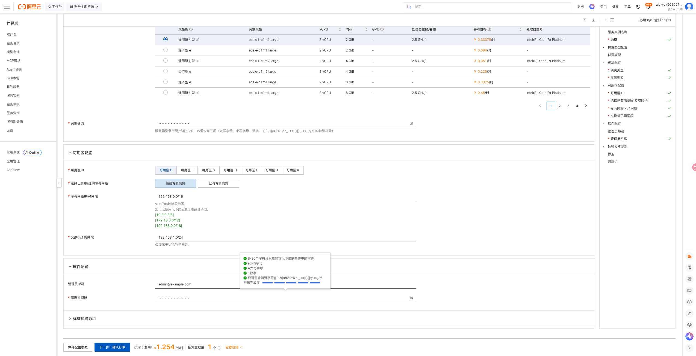
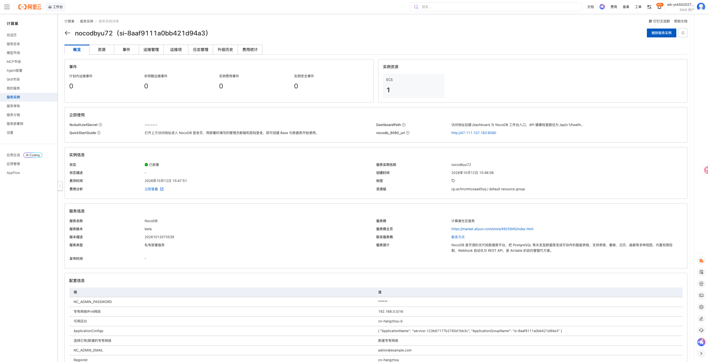
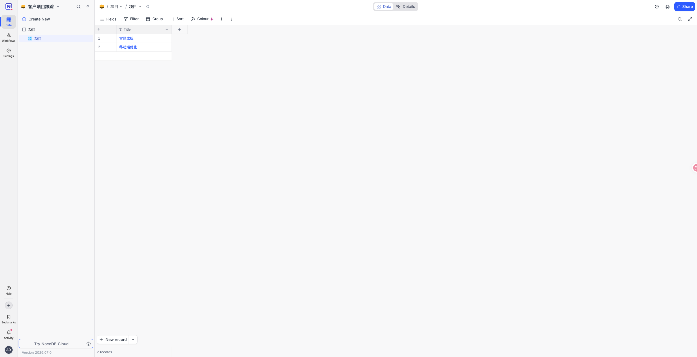

# NocoDB 计算巢部署文档

## 概述

[NocoDB](https://github.com/nocodb/nocodb) 是可自托管的无代码数据库平台，可将数据组织为智能表格，并提供多种视图、权限控制、Webhook 和 REST API。本方案通过 Docker Compose 将 NocoDB、后台 Worker、PostgreSQL 和 Redis 部署在用户自己的 ECS 中。

| 项目 | 说明 |
| --- | --- |
| 服务 ID | `service-123b67177b2740d1bb3c` |
| 部署形态 | 单台 ECS + Docker Compose |
| 应用版本 | NocoDB 2026.07.0 |
| 访问端口 | 8080（Web UI 与 API） |
| 数据存储 | ECS `/opt/nocodb` 下的 Docker 持久化数据 |
| 数据库与缓存 | PostgreSQL 17 + Redis 7 |
| 实测部署耗时 | 约 2 分钟 |

## 部署架构

```text
浏览器
  │ HTTP 8080
  ▼
安全组
  ▼
ECS
  └─ Docker Compose
       ├─ NocoDB Web（8080）
       ├─ NocoDB Worker
       ├─ PostgreSQL 17
       └─ Redis 7
```

计算巢通过 ROS 创建 VPC、交换机、安全组和 ECS，并通过云助手启动 Docker Compose。PostgreSQL 保存账号、Workspace、Base、表结构和记录等业务数据，Redis 为应用提供缓存与后台任务支持。

## 部署前准备

### 账号与权限

请使用已完成实名认证的阿里云账号，并确保账号可以创建以下资源：

- 计算巢服务实例；
- ROS 资源栈；
- ECS 实例、系统盘与安全组；
- VPC 和交换机。

使用 RAM 用户部署时，应由管理员授予上述资源的创建、查询和删除权限。

### 计费说明

部署会创建一台 ECS、200 GiB ESSD 系统盘并使用公网带宽。费用以创建页实时询价和阿里云账单为准。测试场景建议选择按量付费，并在验证结束后及时删除服务实例。

## 部署步骤

### 1. 打开创建页面

访问 [NocoDB 服务实例创建页](https://computenest.console.aliyun.com/service/instance/create/cn-hangzhou?type=user&ServiceId=service-123b67177b2740d1bb3c)。



### 2. 配置部署参数

| 参数 | 说明 | 建议 |
| --- | --- | --- |
| 服务实例名称 | 控制台中用于识别本次部署 | 保持默认或自定义 |
| 地域、可用区 | ECS 所在位置 | 选择接近使用者且有库存的位置 |
| 付费类型 | 按量付费或包年包月 | 测试使用按量付费 |
| 实例类型 | ECS 规格 | 2 vCPU / 2 GiB 起 |
| 实例密码 | ECS 登录密码 | 使用符合页面规则的强密码 |
| 专有网络 | 新建或复用 VPC | 首次部署可选择新建 |
| VPC/交换机网段 | 网络地址范围 | 无冲突时保持默认 |
| 管理员邮箱 | NocoDB 超级管理员账号 | 使用可识别的管理员邮箱 |
| 管理员密码 | NocoDB 超级管理员密码 | 使用独立强密码 |

管理员密码和 ECS 密码相互独立。请勿在公开文档、工单、日志或代码仓库中记录密码。

填写完成并看到询价结果后，点击“下一步：确认订单”，核对资源和费用，勾选服务协议并创建实例。

### 3. 等待部署完成

进入服务实例详情页，等待状态变为“已部署”。本次实测从创建到部署完成约 105 秒。



“立即使用”区域会显示：

- `nocodb_8080_url`：NocoDB 访问地址；
- `QuickStartGuide`：登录与使用说明；
- `DashboardPath`：工作台和健康检查路径；
- `NcAuthJwtSecret`：系统自动生成的 JWT 签名密钥，属于敏感信息，请勿复制、分享或写入公开材料。

### 4. 登录并使用

打开 `nocodb_8080_url`，使用部署时填写的管理员邮箱和管理员密码登录。登录后可创建 Base、数据表、字段和记录。

发布前实测已完成以下验证：

1. 创建 Base“客户项目跟踪”；
2. 创建数据表“项目”；
3. 新增“官网改版”和“移动端优化”两条记录；
4. 刷新页面后确认 Base、表和记录仍然存在。



## 可用性验证

| 验证项 | 结果 |
| --- | --- |
| 服务实例 | 状态为“已部署” |
| 应用访问 | NocoDB 登录页和工作台正常加载 |
| 身份认证 | 管理员账号可正常登录 |
| Base 与数据表 | 可正常创建 |
| 数据读写 | 两条测试记录成功保存 |
| 数据持久化 | 刷新页面后数据仍存在 |

## 数据与安全

- NocoDB、PostgreSQL 和 Redis 数据保存在 ECS 的 Docker 持久化数据中；删除 ECS 或服务实例前请先导出或备份重要数据。
- 应用启用了管理员登录认证，但默认访问链路为公网 HTTP 8080。生产环境建议限制安全组来源，并配置 HTTPS 反向代理。
- 管理员密码、ECS 密码和 JWT 签名密钥均属于敏感信息，不应写入文档、日志或公开仓库。
- 建议定期备份 PostgreSQL 数据，并在升级 NocoDB 前验证备份可恢复。
- NocoDB 使用 Sustainable Use License，生产或商业使用前请阅读并遵守官方许可证条款。

## 资源释放

不再使用时，在计算巢服务实例详情页执行“删除”。删除完成后建议继续确认：

1. 服务实例已不存在；
2. ROS 资源栈状态为 `DELETE_COMPLETE`；
3. ECS、VPC、交换机和安全组均无残留；
4. 账单中不再产生相关按量资源费用。

删除服务实例会同时删除 ECS 及其本地数据，请提前导出或备份 Base、表结构、记录和应用配置。

## 官方链接

- [NocoDB 官方仓库](https://github.com/nocodb/nocodb)
- [NocoDB 官方文档](https://docs.nocodb.com/)
- [NocoDB 自托管文档](https://docs.nocodb.com/getting-started/self-hosted/)
- [NocoDB 许可证](https://github.com/nocodb/nocodb/blob/develop/LICENSE.md)
- [阿里云计算巢文档](https://help.aliyun.com/zh/compute-nest/)
